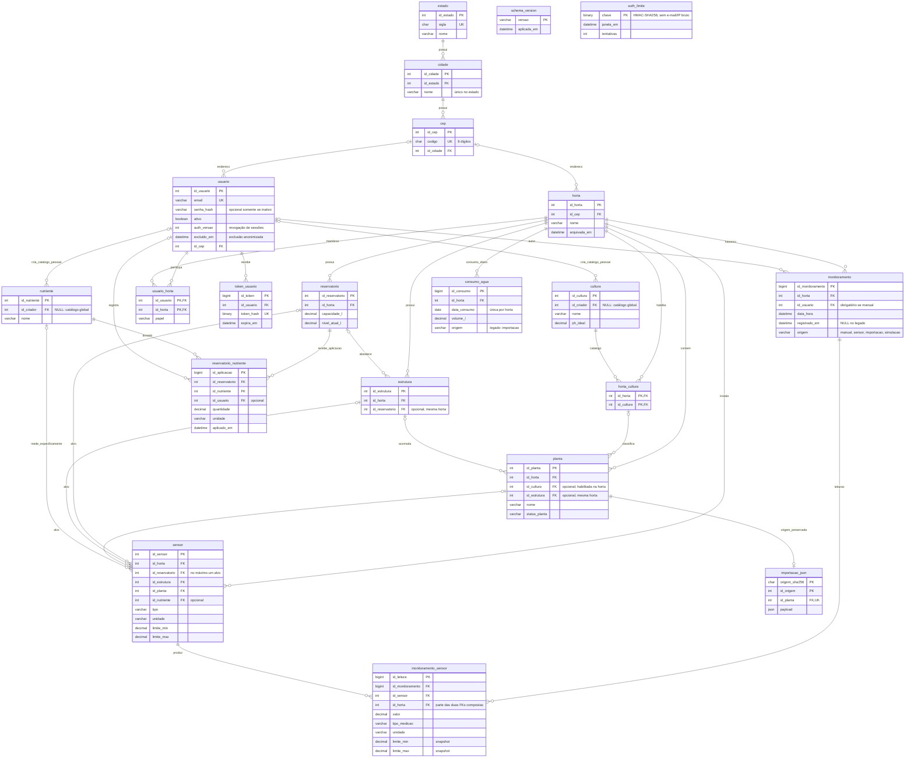

# Hydroponex — diagrama entidade-relacionamento

As cardinalidades indicam o que o banco permite. Uma horta ativa deve ter pelo menos um proprietário, regra transacional da aplicação. `o|` representa referência opcional. As FKs compostas incluem `id_horta` para garantir a mesma horta em ambos os lados.

`schema_version` e `auth_limite` são tabelas técnicas sem relacionamento de domínio. Sensor sem alvo específico mede o ambiente da própria horta; com alvo, escolhe exatamente um entre reservatório, estrutura e planta. Cada monitoramento admite uma leitura por sensor; nova amostra cria outro monitoramento. O vínculo direto de horta em `monitoramento_sensor` é controlado pelas duas FKs compostas, não é um endereço ou uma associação independente.

Schema 1.2.0: autoria opcional em cultura/nutriente distingue catálogo global de pessoal. Itens pessoais ficam consultáveis pelos membros das hortas que os utilizam; edição/exclusão pelo criador somente sem vínculos. Autoria usa RESTRICT; exclusão de conta é anonimizada. Aplicações e leituras preservam o histórico. Veja [INFRAESTRUTURA.md](INFRAESTRUTURA.md).

Schema 1.3.0: limites de sensor são copiados para cada leitura. Evento guarda coleta UTC e recebimento; simulações são explícitas. Tipo/unidade/alvo do sensor com histórico são protegidos pela aplicação. Consumo tem origem, sem presumir procedência do legado. Veja [MONITORAMENTO.md](MONITORAMENTO.md).
