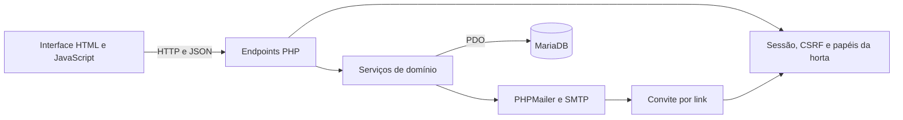

# Arquitetura da aplicação

O navegador carrega `public/index.html` e os arquivos em `public/assets/`. Os scripts JavaScript chamam as APIs JSON em `public/php/api/`, mantendo as rotas relativas `php/api/` tanto no Apache quanto no servidor de desenvolvimento.

`public/php/config/` centraliza conexão, sessão e autenticação. `public/php/services/` contém as operações compartilhadas pelos endpoints. `public/php/storage/` conserva o JSON legado usado pelo importador CLI, enquanto as APIs consultam o banco. As pastas internas têm regras `.htaccess` de bloqueio e o router aplica a proteção equivalente no servidor embutido.

O Apache do XAMPP atende a aplicação em `/hydroponex/` a partir de `htdocs/hydroponex`. Essa pasta recebe o conteúdo de `public/` e o marcador de configuração criado pelo instalador. A configuração privada fica em `<XAMPP>/hydroponex-private/`. SQL, testes e documentação ficam na pasta do repositório.

A API vincula ações sobre uma horta ao papel registrado em `usuario_horta`. A autenticação usa hash de senha e sessão PHP, com renovação da sessão no login e validação CSRF nas operações de escrita. A conexão PDO usa consultas preparadas e uma conta de aplicação com permissões de leitura e escrita restritas ao banco do projeto.

Contratos por módulo:

- [Autenticação e perfil](../apis/AUTENTICACAO.md)
- [Hortas e papéis](../apis/HORTAS.md)
- [Plantas e importação de JSON](../apis/PLANTAS.md)
- [Culturas e infraestrutura](../apis/INFRAESTRUTURA.md)
- [Sensores, monitoramento e dashboard](../apis/MONITORAMENTO.md)
- [Modelo relacional](../banco-de-dados/diagrama.md)
- [Equipe e convites](../apis/EQUIPE.md)
- [Painel operacional](../apis/OPERACIONAL.md)
- [Tarefas e intervenções](../apis/TAREFAS.md)
- [Validação integrada](../desenvolvimento/VALIDACAO-FINAL.md)
